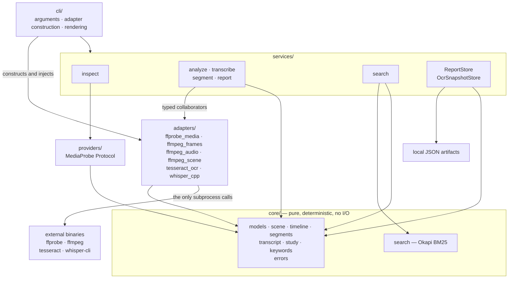
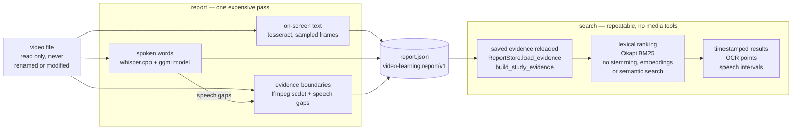

# LearnLens (`video-learning-studio`)

A local-first CLI for turning videos stored on your Mac into searchable study
evidence.

Long recordings are hard to navigate: the useful moment is somewhere in the
middle, and finding it means scrubbing. LearnLens reads a video once, extracts
what is actually observable — media metadata, on-screen text, spoken words, and
visual-change boundaries — and saves it as a plain JSON artifact. You can then
search that artifact as often as you like without ever re-processing the video.

The application runs locally. `uv sync` may access PyPI to install the two
Python dependencies. The only Python dependencies are `typer` and `rich`; all
media work is delegated to external binaries (`ffprobe`, `ffmpeg`,
`tesseract`, `whisper-cli`) through `subprocess`. No module in `src/` makes a
network call, no model is ever downloaded, and there is no cloud fallback. The
source video is only ever read — never renamed, moved, or modified.

## Quick start

```bash
uv sync
uv run video-learning report "/path/to/clip.mov" --out report.json
uv run video-learning search report.json "a phrase from the video"
```

`uv sync` installs the two Python dependencies. In this workflow, `report` opens
the video: it samples frames, reads their text, transcribes speech, and detects
boundaries, then writes everything into one JSON artifact. Each `search` after it
reads that artifact and re-runs none of that work. Spoken-audio transcription
needs both an installed, usable `whisper-cli` on `PATH` **and** a configured
compatible ggml model — pass `--model /path/to/ggml-model.bin` or export
`VLS_WHISPER_MODEL`.

Which external binary each command needs, and how to install it, is in
[Requirements](#requirements); the annotated walk-through is in
[End-to-end example, annotated](#end-to-end-example-annotated).

**Transcription is optional by design.** Without `whisper-cli`, or without a
configured model, `report` still succeeds and still produces a searchable
artifact: it records `transcription.status` as `unavailable` together with the
reason, and the on-screen text it did read is stored and ranked exactly as it
would be alongside speech evidence.

### Sample output

This is real CLI output, produced from the project's own synthetic test fixture
(`tests/unit/test_search_cli.py`) — one OCR snapshot and six transcript segments
of invented sentences, with no real video involved. It is shown unwrapped; on a
narrower terminal the two closing notes wrap.

```console
$ uv run video-learning search report.json "index locally"
SEARCH
────────────────────────────────
Query:  index locally
Source: clip.mov
Status: ok

00:00:00.5  OCR     build a search index locally
  score 1.739 · segment 0 · matched index, locally
00:00:00.0 → 00:00:03.0  SPEECH  the index ranks record 0
  score 0.065 · segment 0 · matched index
00:00:04.0 → 00:00:07.0  SPEECH  the index ranks record 1
  score 0.065 · segment 0 · matched index
00:00:08.0 → 00:00:11.0  SPEECH  the index ranks record 2
  score 0.065 · segment 0 · matched index
00:00:12.0 → 00:00:15.0  SPEECH  the index ranks record 3
  score 0.065 · segment 0 · matched index

Showing 5 of 7 matching records (limit 5); the limit caps what is returned, never what is considered.
Read from the saved report artifact — the video was not opened and no frame extraction, OCR, transcription or segmentation was re-run.
```

An OCR record is one moment, so it prints a single timestamp; a speech record is
a range. The OCR hit ranks first here because it is the only record carrying
`locally`, while the speech records match on `index` alone.

## Architecture

Five packages, with dependencies pointing inward:

```
cli/        parse arguments -> call a service -> render output
services/   one use case per class; orchestration, no CLI concerns
core/       pure, deterministic logic and data models; no I/O
adapters/   every subprocess boundary (ffprobe, ffmpeg, tesseract, whisper.cpp)
providers/  the MediaProbe Protocol — the single provider seam so far
```

Arrow heads point at the thing depended upon:



There is no arrow from `search` to `adapters/`: the search service is the one use
case that reaches only `core/`.

Adapters are constructed at the CLI root and injected into services, so the pure
core never reaches for a binary. `core/search.py` implements Okapi BM25 over
already-extracted evidence; `services/search_service.py` builds one index per
artifact and delegates each query to it. `services/search_service.py` imports
only `core/`, and the `search` command's whole path —
`ReportStore.load_evidence`, then `SearchService.query` — performs one
`read_text` and no subprocess call. The absence of media processing is
structural, not a promise: `subprocess` is imported in `adapters/` and nowhere
else in `src/`.

The same split, as the two paths a user takes:



Nothing crosses from `VIDEO` into the search subgraph: a query reads only the
artifact. Transcription is the one pass that may be unavailable; OCR points are
still written, and segmentation still runs with no speech gaps to merge.

`core/study_guide.py` and `core/quiz.py` (with their services) exist as library
code and are covered by unit tests, but **no CLI command exposes them yet**.

## Command reference

| Command | Purpose | External binaries |
| --- | --- | --- |
| `inspect` | Media metadata | `ffprobe` |
| `analyze` | Suggest keywords/phrases from on-screen text | `ffprobe`, `ffmpeg`, `tesseract` |
| `transcribe-audio` | Timestamped transcript of spoken audio | `ffprobe`, `ffmpeg`, `whisper-cli` + model |
| `save-ocr` | Persist complete OCR evidence to a JSON artifact | `ffprobe`, `ffmpeg`, `tesseract` |
| `report` | Combine everything into one artifact | all of the above (whisper optional) |
| `search` | Query a saved report artifact | **none** |

```
video-learning inspect VIDEO [--json]
video-learning analyze VIDEO [--json]
video-learning transcribe-audio VIDEO [--model PATH] [--json]
video-learning save-ocr VIDEO --out PATH [--json]
video-learning report VIDEO [--out PATH] [--model PATH] [--json]
video-learning search ARTIFACT QUERY [--limit INT] [--json]

video-learning --version
```

Every command accepts `--json` for machine-readable output on stdout. User-facing
failures print `Error: <message>` to stderr and exit `1`, without a traceback.

The examples below use `video-learning` directly. From a fresh clone, prefix each
command with `uv run` (for example `uv run video-learning inspect …`) so the
project environment is used.

## `inspect` — media metadata

```
video-learning inspect "/path/to/video.mov"
video-learning inspect "/path/to/video.mov" --json
```

Reports container, duration, dimensions, frame rate, pixel format, and the video
and audio codecs, sample rate, channels, and language tag, via `ffprobe`.

Metadata describes the **first** video stream and the **first** audio stream that
`ffprobe` lists. Attached pictures (album art) are not treated as video streams.

## `analyze` — on-screen keyword suggestions

```
video-learning analyze "/path/to/video.mov"
video-learning analyze "/path/to/video.mov" --json
```

`analyze` samples a few frames with `ffmpeg`, reads their on-screen text with
`tesseract`, and ranks the words it actually observed into suggested keywords.
It suggests descriptive content only — it never generates a date/time prefix,
never infers a device name, and never rewrites your existing filename. Those are
yours to keep.

Suggestions are derived from the same OCR pass that produced the text, so nothing
is re-extracted. At most 12 keywords and 8 phrases are returned.

## `transcribe-audio` — local speech transcription

```
video-learning transcribe-audio "/path/to/video.mov"
video-learning transcribe-audio "/path/to/video.mov" --model "/path/to/ggml-base.en.bin"
video-learning transcribe-audio "/path/to/video.mov" --json
```

Extracts the audio to a temporary 16 kHz mono WAV, transcribes it with local
`whisper.cpp`, and returns segments with `start_seconds`, `end_seconds`, and
`text`. The temporary directory is removed automatically. The transcript is
evidence for the human — no filenames or keywords are derived from it.

**Setup.** `whisper-cli` must be on `PATH`, and a whisper.cpp **ggml** model must
be configured. When the binary is missing, the tool's own error message suggests
`brew install whisper-cpp`. Models are never downloaded; you supply one:

```
# Option 1 — pass it explicitly (takes precedence)
video-learning transcribe-audio "/path/to/video.mov" --model "/path/to/ggml-base.en.bin"

# Option 2 — configure it once for the shell session
export VLS_WHISPER_MODEL="/path/to/ggml-base.en.bin"
video-learning transcribe-audio "/path/to/video.mov"
```

Model resolution checks `--model` first, then `VLS_WHISPER_MODEL` (a leading `~`
is expanded). There are **no default search locations** — if neither points at an
existing file, transcription is reported as unavailable. PyTorch `.pt`
checkpoints are not ggml models and will not work.

Before running, the command probes capability: it confirms `whisper-cli` is on
`PATH` *and actually executes* (a shim that exits `127` is reported as unusable,
not as installed). If prerequisites are unmet it prints the capability report
plus an actionable error and exits `1` without attempting transcription. With
`--json` that case emits `{"capability": …, "transcription": null, "error": …}`.

There is no `--language` option: the adapter always passes whisper.cpp language
`auto`. An `.en` model is English-only by construction, and the capability report
labels the language "English" when the model name ends in `.en`.

## `save-ocr` — OCR snapshot persistence

```
video-learning save-ocr "/path/to/video.mov" --out "/path/to/evidence.json"
video-learning save-ocr "/path/to/video.mov" --out "/path/to/evidence.json" --json
```

Runs the same read-only analysis as `analyze` (`ffmpeg` + `tesseract`) and writes
the **complete** OCR text of every timestamped snapshot alongside the
deterministic phrases/keywords already derived from that same text. The result is
a single schema-tagged JSON document (`video-learning.ocr-snapshots/v1`) that is:

- **deterministic** — stable ordering with no wall-clock timestamps or random
  IDs, so the same video yields byte-identical output;
- **non-destructive** — the source video is never renamed, moved, or modified;
- **complete** — the full OCR text is preserved, never replaced by suggestions.

No database, cloud storage, or new Python dependency is introduced; the artifact
is an ordinary local file. `--out` is required, and its parent directories are
created if missing. An existing artifact at that path is overwritten.

This artifact is for auditing OCR evidence. `search` does **not** read it — see
below.

## `report` — combined evidence artifact

```
video-learning report "/path/to/video.mov"
video-learning report "/path/to/video.mov" --out "/path/to/report.json"
video-learning report "/path/to/video.mov" --json
video-learning report "/path/to/video.mov" --model "/path/to/ggml-base.en.bin"
```

A thin orchestration layer that **reuses** `InspectService`, `AnalyzeService`,
`TranscribeService`, and `SegmentService` (plus their existing result models). It
is not a second implementation of OCR or transcription.

### Report structure

Schema `video-learning.report/v1`, with these sections:

- **`metadata`** — duration, dimensions, frame rate, video/audio codecs, audio
  presence, sample rate, and channels, taken from the existing inspection model.
  Volatile filesystem values (mtime, size) are omitted so output stays
  deterministic.
- **`ocr`** — `snapshots` (each with `timestamp_seconds` and the **complete**
  `ocr_text`), the `phrases` and `keywords` derived from that same text,
  `frames_analyzed`, and `ocr_text_chars`.
- **`transcription`** — `status`, `detail`, `backend`, `model`, `language`,
  `segments` (`start_seconds`/`end_seconds`/`text`), and `segment_count`.
- **`timeline`** — OCR and speech as **distinct** event types: OCR is a point
  (`{"type": "ocr", "timestamp_seconds": …, "text": …}`) and speech is an interval
  (`{"type": "speech", "start_seconds": …, "end_seconds": …, "text": …}`). Events
  are sorted chronologically with deterministic tie-breaking (an OCR point sorts
  before a speech interval at the same time; equal keys keep input order). No
  semantic alignment between OCR and speech is attempted.
- **`segments`** — deterministic visual/speech segmentation:
  - `visual_changes` — timestamps and change scores from an `ffmpeg` `scdet` pass
    at threshold `10.0`;
  - `speech_boundaries` — gaps of at least `2.0` s between transcript segments;
  - `boundaries` — candidates merged within a `1.0` s tolerance, each keeping the
    evidence it came from and a `reason`;
  - `segments` — the assembled `start_seconds`/`end_seconds`/`boundary_reason`
    list. A boundary that would create a segment shorter than `2.0` s is not
    promoted;
  - `video_duration_seconds`, `segment_count`, and the four threshold constants
    above, echoed so a reader can recompute the result from the artifact alone.
- **`renamed` / `applied` / `source_modified`** — always `false`.

The final segment ends at the exact authoritative duration from `ffprobe`, never
at a duration estimated from evidence timestamps. If `ffprobe` reported no
duration, no segments are assembled, but all evidence is retained and the unknown
duration is recorded explicitly.

Scene detection is a **full decode pass** over the video, so `report` is the
slowest command; its cost scales with video length, not with the number of OCR
samples.

### Transcription status

Transcription is never faked:

- `no-audio` — the video has no audio stream, so transcription is skipped and the
  metadata + OCR report is still produced;
- `unavailable` — audio is present but the local whisper.cpp backend/model is
  missing or unusable; the report records an explicit, deterministic reason and
  no provenance is invented;
- `ok` — transcription ran; backend/model/language/segments are included.

With `--out PATH` the report is written as a schema-tagged JSON artifact;
`--json` prints that same report (`result.to_dict()`, with no CLI-only fields).
Parent directories are created if missing and an existing artifact is
overwritten. The terminal report is concise: OCR timeline entries show a short
preview while the artifact retains the complete OCR text.

The report is deterministic (stable ordering, no wall-clock timestamps, no random
IDs), so the same video with the same available backends/models yields a
byte-identical artifact.

## `search` — artifact-backed evidence search

```
video-learning search "/path/to/report.json" "a phrase from the video"
video-learning search "/path/to/report.json" "another phrase" --limit 10
video-learning search "/path/to/report.json" "another phrase" --json
video-learning search "/path/to/report.json" "another phrase" --limit 0
```

**Search reads the saved artifact, not the video.** `ARTIFACT` must be a
`video-learning.report/v1` document written by `report --out`. The video is never
opened: no `ffmpeg`, no `tesseract`, no `whisper.cpp`, no network. Nothing is
re-extracted, so a query costs one lexical pass over text that already exists.
A `save-ocr` artifact (`video-learning.ocr-snapshots/v1`) is **not** accepted.

Both modalities are searchable: every OCR snapshot and every transcript segment
becomes a record, ranked with Okapi BM25 (`k1 = 1.5`, `b = 0.75`). Records are
ordered by score descending, then by start time ascending, then by evidence ID.
Matching is lexical — there is no stemming, synonym expansion, embedding, or
semantic search.

### Result fields

Each entry in `results`:

| Field | Meaning |
| --- | --- |
| `evidence_id` | `ocr:N` or `speech:N`, indexing the artifact's own arrays |
| `source_type` | `ocr` or `speech` |
| `text` | The complete, verbatim evidence text |
| `start_seconds` | OCR timestamp, or speech interval start |
| `end_seconds` | Speech interval end; `null` for OCR, which is a point |
| `segment_id` | Index of the segment this evidence was attributed to; `null` if unattributed |
| `score` | BM25 relevance score (see limitations) |
| `matched_terms` | Distinct matched terms, in first-occurrence order |
| `matched_spans` | `{term, surface, start, end}` offsets into `text` |

`text[start:end] == surface` holds for every span. Spans can nest (a compound and
one of its parts can both match), so highlighting should paint longest-first.
`term` is the case-folded matching key; `surface` quotes the evidence exactly.

### Coverage fields

`coverage` explains what was indexed and what the query reached, as counts only:

| Field | Meaning |
| --- | --- |
| `record_count` | Records projected from the artifact |
| `searchable_record_count` | Subset carrying at least one meaningful term; only these are scored |
| `speech_record_count` / `ocr_record_count` | Per-modality totals |
| `attributed_record_count` / `unattributed_record_count` | Records with / without a segment |
| `query_token_count` | All tokens the tokenizer produced from the query |
| `meaningful_query_term_count` | Distinct query terms with search intent — the set BM25 scored |
| `matched_record_count` | Records that matched, **before** the limit |
| `returned_record_count` | Records actually returned |

The gap between `query_token_count` and `meaningful_query_term_count` shows when a
query was entirely stopwords or UI chrome. The gap between `matched_record_count`
and `returned_record_count` shows when an answer was capped.

The top-level fields of a `search --json` response are `schema` (the value
`video-learning.search/v1`), `status`, `query`, `source`, `limit`,
`result_count`, `results`, `coverage`, `video_duration_seconds`,
`transcription_status`, `transcription_available`, and `study_evidence_schema`.

### Statuses

- `ok` — at least one record shared a meaningful query term.
- `no_confident_match` — the query carried no meaningful term, or no record
  matched one. This is an answer, not an error; the exit code is still `0`.
- `no_evidence` — nothing in the artifact is matchable at all. `record_count`
  still reports what was projected, so this does not mean "the video produced no
  evidence".

An empty answer is explained from the coverage counts rather than reported as a
generic "no results".

### `--limit` and `--json`

`--limit` defaults to `5`. It caps what is **returned**, never what is
considered — `matched_record_count` always reports the full total. `--limit 0`
(or any non-positive value) returns no results but still reports the status and
every coverage count, which is useful for asking "would anything match?" without
printing evidence.

`--json` emits exactly the result model, so stdout is strictly valid JSON and can
be piped into another tool.

## End-to-end example, annotated

Placeholders only — substitute your own paths.

```bash
VIDEO="/path/to/your-video.mov"
MODEL="/path/to/ggml-base.en.bin"
ARTIFACT="/path/to/report.json"

# 1. Confirm the file is readable media and see what streams it has.
uv run video-learning inspect "$VIDEO"

# 2. Process it once. Writes the artifact; the video is only read.
uv run video-learning report "$VIDEO" --model "$MODEL" --out "$ARTIFACT"

# 3. Read the artifact to see what was actually observed, then query it.
#    Pick phrases from the transcript and from the OCR text.
uv run video-learning search "$ARTIFACT" "a phrase you saw in the transcript"
uv run video-learning search "$ARTIFACT" "a phrase you saw on screen" --json

# 4. Ask how many records would match, without printing them.
uv run video-learning search "$ARTIFACT" "some term" --limit 0
```

Step 2 is the only expensive step. Steps 3 and 4 re-read the artifact and never
touch the video, so you can repeat them freely.

If you have no whisper.cpp model, omit `--model`: the report still contains
metadata, OCR, timeline, and segments, with `transcription.status` set to
`unavailable` and an explicit reason.

## Requirements

- Python 3.11+
- [uv](https://docs.astral.sh/uv/)
- FFmpeg/ffprobe on `PATH` (`brew install ffmpeg`)
- Tesseract on `PATH` (`brew install tesseract`) — required for `analyze`,
  `save-ocr`, and `report`
- whisper.cpp's `whisper-cli` on `PATH` plus a ggml model — required only for
  transcription (`transcribe-audio`, and the speech portion of `report`)

`search` and `inspect` need no model. `inspect` needs only `ffprobe`.

### OCR language configuration

Tesseract is invoked with `-l eng`. English is the only configured language; no
other language pack is selected and there is no CLI option to change it.
Non-English text that uses Latin script may still be partially recognized, but
this is **not** multilingual OCR and accuracy on other languages is not
established.

## Known limitations

- **OCR samples at most five frames**, regardless of video length. Frames are
  taken at the midpoints of five equal slices, so anything shown between those
  moments is not in the evidence.
- **Tesseract uses English OCR only** (see above). Diacritics and non-English
  punctuation are frequently misread.
- **OCR quality varies with screen density and image quality.** Dense UI, small
  text, and low contrast produce garbled output. Interface chrome (menu bars, tab
  titles, URLs) is read as content and can dominate the suggested keywords and
  phrases.
- **Only the first audio stream is selected.** Metadata describes the first audio
  stream `ffprobe` lists, and audio extraction passes no explicit stream mapping,
  so FFmpeg's default selection applies. There is no option to choose a track, and
  the artifact cannot identify which track was transcribed in a multi-track file.
- **BM25 scores are relevance scores, not calibrated confidence probabilities.**
  They are unbounded, depend on the corpus, and are comparable only within one
  query against one artifact. There is no score threshold, so a weak single-term
  match is still returned with status `ok`.
- **Retrieval quality has not been evaluated on a representative dataset.** The
  ranking is exercised by unit tests over synthetic evidence and was checked
  manually on one real recording, where an OCR query and a speech query each
  returned relevant evidence. No precision, recall, or ranking-quality metric has
  been measured.
- **Visual segments are not necessarily semantic chapters.** They are
  evidence-derived boundaries from pixel change and speech gaps. No topic
  detection or semantic interpretation is performed.
- **Readable search output shows an excerpt, not the whole record.** An OCR line
  is windowed around the first matched term within a roughly 90-character budget.
  Matched text is printed exactly as the artifact stores it and is never cut to
  fit the budget, so the line can be longer; the context around it is folded to
  single spaces, and `…` marks text elided at either end. A match that falls
  outside that window is not displayed, and a speech record still shows a plain
  preview of its opening. Use `--json` to see the complete text and the exact
  `matched_spans`. This excerpting applies to `search` only; the `report`
  timeline continues to show a short preview of each OCR point and takes no
  match into account.
- **`--json` carries an absolute source path.** A report artifact stores the
  video's own path in its `source` field, and `search --json` echoes that path
  back as `source`; the readable listing prints only the filename. Treat an
  artifact you intend to share the way you would a shell history.

## Troubleshooting

Errors are printed as `Error: <message>` on stderr with exit code `1` and no
traceback.

| Symptom | Cause and fix |
| --- | --- |
| `ffprobe was not found on PATH` | Install FFmpeg (`brew install ffmpeg`). Required by every command except `search`. |
| `ffmpeg`/`tesseract` not found on PATH | Install the missing binary (`brew install ffmpeg`, `brew install tesseract`). |
| `whisper-cli was not found on PATH` | Install whisper.cpp; the tool suggests `brew install whisper-cpp`. |
| `found at … but exited 127 (broken shim)` | A `whisper-cli` entry exists on `PATH` but cannot run in the active environment. Install a working binary rather than relying on the shim. |
| `No whisper.cpp model configured` | Pass `--model PATH` or set `VLS_WHISPER_MODEL` to an existing **ggml** model file. Models are never downloaded. |
| `whisper.cpp model not found at '<path>'` | The explicit `--model` path is not an existing file. Check the path; `.pt` checkpoints are not ggml models. |
| Report says `transcription.status: "no-audio"` | The video has no audio stream. This is expected; metadata, OCR, timeline, and segments are still produced. |
| Report says `transcription.status: "unavailable"` | Audio exists but the backend or model was unusable, or a run failed. `transcription.detail` gives the reason. The rest of the report is still valid. |
| `Could not read report artifact '<path>'` | The artifact is missing or unreadable. Check the path passed to `search`. |
| `Report artifact '<path>' is not valid JSON` | The file is truncated or was edited by hand. Regenerate it with `report --out`. |
| `Unsupported report artifact schema in '<path>'` | `search` accepts only `video-learning.report/v1`. A `save-ocr` artifact or a document from another version is rejected rather than guessed at. |
| `Report artifact '<path>' is missing the '<section>' section` | The artifact lacks `segments`, `timeline`, `transcription`, or `source`. Regenerate it with `report --out`. |
| `Search returns no_confident_match` | The query had no meaningful term (all stopwords or UI chrome), or no record contains one. Compare `meaningful_query_term_count` and `matched_record_count` in `coverage`. |
| `Search returns no_evidence` | Nothing in the artifact is searchable — for example a report whose OCR text was blank and whose transcription was unavailable. |
| `report` is slow | Scene detection decodes the whole video. Cost scales with duration. |

## Development

```
uv sync
uv run pytest
uv run ruff check .
uv run mypy
```

`mypy` runs in strict mode over `src/`. Ruff is configured for a 100-character
line length.

Run `uv run pytest` to execute the test suite. Unit tests do not require media
tooling. Integration tests may require external binaries and
`VLS_WHISPER_MODEL`; tests with unmet prerequisites may be skipped. Review the
test summary, including skipped tests, when evaluating a run.

### How the tests are layered

- **Unit tests** (`tests/unit/`) — the bulk of the suite. External binaries are
  mocked and evidence is synthetic, so these run anywhere with no media tooling
  installed. They cover the pure core (tokenization, BM25 scoring and ordering,
  segmentation, timeline, keyword/phrase ranking), the adapters' parsing and
  error mapping, artifact round-trips, and the CLI's argument handling, JSON
  contracts, and error exits.
- **Generated-media integration tests** (`tests/integration/`) — these create
  their own small fixtures with `ffmpeg` (drawn text, a sine tone, a colour
  change) and then run the **real** binaries against them. They verify the
  pipeline end to end, not specific recognized words. They skip automatically
  when the required binaries are absent; the transcription one additionally
  requires a usable `whisper-cli` and a configured `VLS_WHISPER_MODEL`. A skipped
  integration test is not a passing one.
- **Real-video verification** — manual, and outside the automated suite. The
  pipeline has been run end to end on a real screen recording, producing a report
  artifact whose OCR and speech evidence were both searchable. There is no
  automated test that consumes a real user video, and no retrieval-quality
  benchmark.

Because integration tests depend on installed binaries and a configured model,
the same commit can exercise different paths on different machines. This
repository has no CI workflow, so no local run stands for any other one: check
the skip count before interpreting a result, and run the suite yourself before
treating any test count as evidence.
